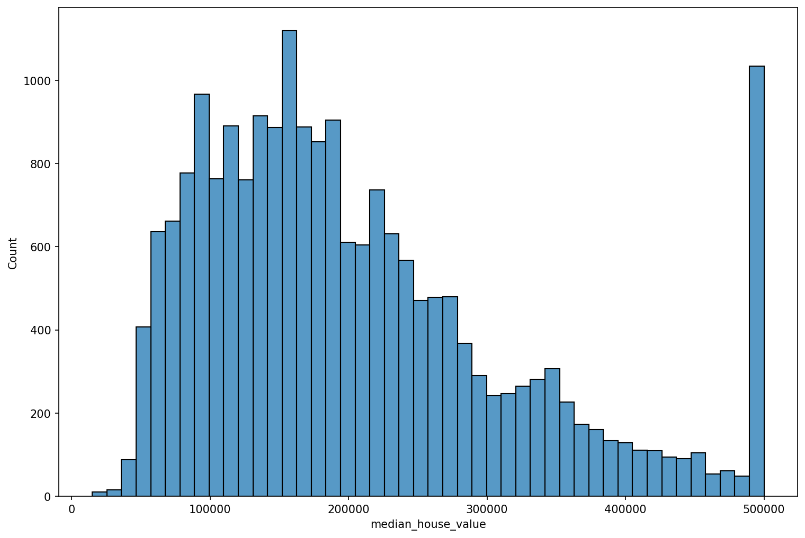
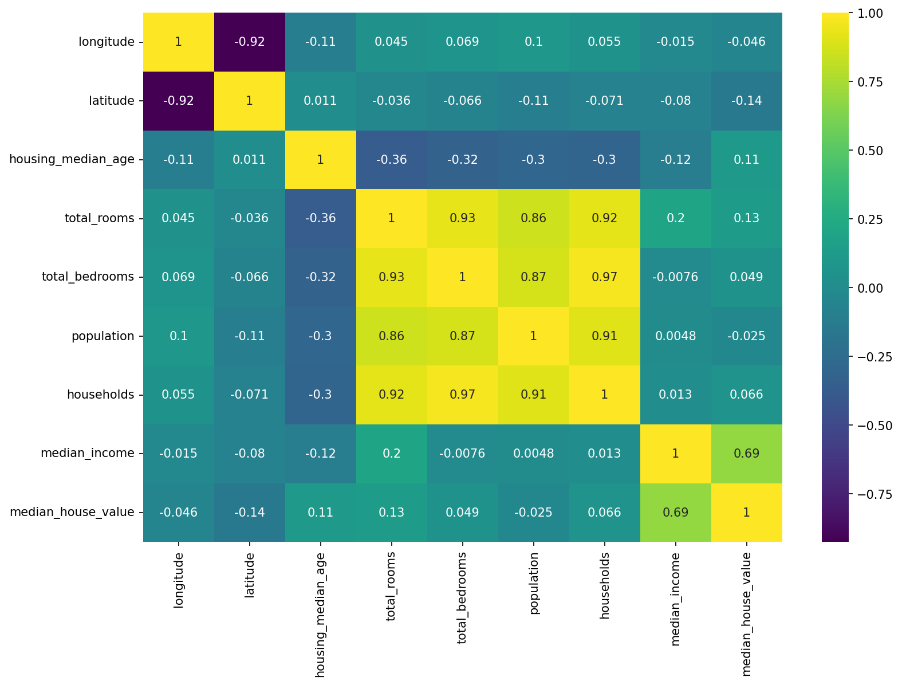

# 🏡 California House Price Prediction

A machine learning project that analyzes California housing data, compares regression models, and predicts median house values. The project includes exploratory data analysis (EDA), feature engineering, model evaluation, hyperparameter tuning, and an interactive Streamlit application.

## 🚀 Live Demo

**[Try the House Price Prediction App](https://house-price-prediction-ml-rcfsthuqqhowawk87jlhma.streamlit.app/)**

## 📌 Project Overview

Predicting house prices is a valuable application of data science in the real estate industry. This project uses housing and demographic features to build regression models that estimate median house values across California districts.

### Project Objectives

- Explore and understand the California housing dataset.
- Clean and preprocess data for machine learning.
- Perform exploratory data analysis to identify patterns and relationships.
- Create additional features to represent housing characteristics.
- Train and compare multiple regression models.
- Apply GridSearchCV for Random Forest hyperparameter tuning.
- Evaluate models using MAE, MSE, RMSE, and R².
- Deploy a trained model using Streamlit.

## 🧰 Technologies Used

- **Programming Language:** Python
- **Data Manipulation:** Pandas, NumPy
- **Data Visualization:** Matplotlib, Seaborn
- **Machine Learning:** Scikit-learn
- **Hyperparameter Tuning:** GridSearchCV
- **Model Persistence:** Joblib
- **Interactive Deployment:** Streamlit
- **Development Environment:** Jupyter Notebook

## 📊 Dataset

- **Dataset:** California Housing Prices
- **Source:** [Kaggle — California Housing Prices](https://www.kaggle.com/datasets/shibumohapatra/house-price)
- **Number of Records:** 20,640
- **Local File:** `housing.csv`
- **Target Variable:** `median_house_value`

The dataset contains information about California housing districts, including geographic location, household income, population, and housing characteristics.

### Features

| Feature | Description |
|---|---|
| `longitude` | Geographic longitude |
| `latitude` | Geographic latitude |
| `housing_median_age` | Median age of houses in a district |
| `total_rooms` | Total number of rooms |
| `total_bedrooms` | Total number of bedrooms |
| `population` | District population |
| `households` | Number of households |
| `median_income` | Median household income |
| `ocean_proximity` | Proximity to the ocean |
| `median_house_value` | Target variable representing median house value |

## 🧹 Data Cleaning and Preprocessing

The data preparation workflow included:

- Inspecting the dataset structure, data types, and missing values.
- Handling missing values in `total_bedrooms`.
- Preparing numerical and categorical variables for model training.
- Separating input features from the target variable.
- Splitting the dataset into training and testing sets.

These steps prepared the data for exploratory analysis and regression modeling.

## 📈 Exploratory Data Analysis (EDA)

EDA was performed to understand the target distribution and investigate relationships between housing features.

### 1. House Price Distribution



The target distribution helps reveal how house values are distributed and whether prices are concentrated within particular ranges.

### 2. Correlation Heatmap



**Key Findings:**

- `median_income` has a strong positive correlation with `median_house_value` (approximately **0.69**).
- `longitude` and `latitude` are strongly negatively correlated (approximately **-0.92**).
- `total_rooms`, `total_bedrooms`, `population`, and `households` are strongly correlated with one another.
- Correlation helps identify relationships between variables but does not establish causation.

## 🛠️ Feature Engineering

Three additional features were created to represent housing characteristics more meaningfully:

- **`room_per_household`:** Total rooms divided by the number of households.
- **`bedrooms_per_room`:** Total bedrooms divided by total rooms.
- **`population_per_house`:** Population divided by the number of households.

These features provide additional information about household size, housing composition, and population density.

## 🤖 Model Training and Evaluation

Three model stages were evaluated:

1. Linear Regression — baseline model.
2. Random Forest Regressor — before hyperparameter optimization.
3. Random Forest Regressor — after GridSearchCV optimization.

The following results reflect the latest recorded evaluation outputs.

### 1. Linear Regression

Linear Regression was used as the baseline model to establish an initial level of predictive performance.

| Metric | Result |
|---|---:|
| Mean Absolute Error (MAE) | 50,670.74 |
| Mean Squared Error (MSE) | 4,908,476,721.16 |
| R² Score | 0.6254 |

**Interpretation:** The model explains approximately 62.54% of the variance in house values on the evaluation dataset.

### 2. Random Forest Regressor — Before Optimization

Random Forest was used to capture more complex relationships between housing characteristics and median house values.

| Metric | Result |
|---|---:|
| Mean Absolute Error (MAE) | 32,444.28 |
| Mean Squared Error (MSE) | 2,546,671,478.91 |
| Root Mean Squared Error (RMSE) | 50,464.56 |
| R² Score | 0.8057 |

**Interpretation:**

- Random Forest substantially reduced MAE compared with Linear Regression.
- Its R² score indicates that the model explains approximately 80.57% of the variance in house values on the evaluation dataset.
- Its performance suggests that it captures patterns not fully represented by the baseline linear model.

### 3. Optimized Random Forest — GridSearchCV

GridSearchCV was used to search for a better combination of Random Forest hyperparameters.

**Best hyperparameters reported:**

| Parameter | Value |
|---|---:|
| `n_estimators` | 100 |
| `max_depth` | 20 |
| `min_samples_split` | 2 |

**Evaluation Results:**

| Metric | Result |
|---|---:|
| Mean Absolute Error (MAE) | 32,447.61 |
| Mean Squared Error (MSE) | 2,549,551,799.38 |
| Root Mean Squared Error (RMSE) | 50,493.09 |
| R² Score | 0.8054 |

**Interpretation:**

- The optimized model achieved an R² score of approximately 0.8054.
- Its MAE, MSE, and RMSE were slightly higher than those of the original Random Forest.
- Hyperparameter tuning did not improve the recorded evaluation results in this experiment.

## 📊 Model Performance Comparison

| Metric | Linear Regression | Random Forest | Optimized Random Forest |
|---|---:|---:|---:|
| MAE ↓ | 50,670.74 | **32,444.28** | 32,447.61 |
| MSE ↓ | 4.91 billion | **2.55 billion** | 2.55 billion |
| RMSE ↓ | Not recorded | **50,464.56** | 50,493.09 |
| R² Score ↑ | 0.6254 | **0.8057** | 0.8054 |

*Lower MAE, MSE, and RMSE indicate smaller prediction errors. A higher R² score generally indicates a better fit.*

## 🏆 Selected Model

**Final Model: Random Forest Regressor (before GridSearchCV optimization)**

The original Random Forest Regressor was selected because it achieved the best results among the three evaluated model stages.

| Evaluation Metric | Selected Random Forest |
|---|---:|
| MAE | 32,444.28 |
| MSE | 2,546,671,478.91 |
| RMSE | 50,464.56 |
| R² Score | 0.8057 |

The model achieved an R² score of **0.8057**, explaining approximately 80.57% of the variance in house values on the evaluation dataset.

Although GridSearchCV was used to tune the Random Forest hyperparameters, the optimized model performed slightly worse on the recorded evaluation metrics. Therefore, the original Random Forest was selected based on these results.

The selected model is saved as `house_price_model.pkl` and is intended to be used by the Streamlit application.

## 🌐 Streamlit Deployment

The project includes an interactive Streamlit application that allows users to enter housing information and obtain a predicted house value.

**[Launch the live application](https://house-price-prediction-ml-rcfsthuqqhowawk87jlhma.streamlit.app/)**

The application loads the saved machine learning model and generates predictions from user-provided features.

## 📁 Project Structure

```text
house-price-prediction-ml/
│
├── house-price-distribution.png
├── correlation-heatmap.png
├── house-price-project.ipynb
├── housing.csv
├── app.py
├── house_price_model.pkl
├── requirements.txt
└── README.md
```

*This structure assumes that both EDA images are stored in the repository root. If they are inside a `screenshots/` directory, update the image links to match their actual locations.*

## ⚙️ Installation and Usage

### Prerequisites

- Python installed on your machine.
- Dependencies listed in `requirements.txt`.

### 1. Clone the Repository

```bash
git clone https://github.com/MOHAMED-RG/house-price-prediction-ml.git
```

### 2. Navigate to the Project Directory

```bash
cd house-price-prediction-ml
```

### 3. Install Dependencies

```bash
pip install -r requirements.txt
```

### 4. Run the Streamlit Application

```bash
streamlit run app.py
```

The application should open in your browser. If it does not, open the local URL displayed in the terminal.

## 🔮 Future Improvements

- Evaluate additional regression algorithms, such as Gradient Boosting and XGBoost.
- Use cross-validation for more robust model selection.
- Investigate feature importance and explain individual predictions.
- Improve application input validation and user experience.
- Test model generalization on unseen data.
- Explore additional features that may improve prediction accuracy.

## 📚 What I Learned

Through this project, I gained practical experience with:

- Cleaning and preparing real-world tabular data.
- Performing exploratory data analysis and interpreting correlations.
- Creating features from existing variables.
- Training and evaluating regression models.
- Comparing models using multiple performance metrics.
- Applying GridSearchCV for hyperparameter tuning.
- Saving trained models with Joblib.
- Integrating a machine learning model into a Streamlit application.
- Documenting a machine learning workflow for reproducibility.

- Explore alternative deployment options.

---


